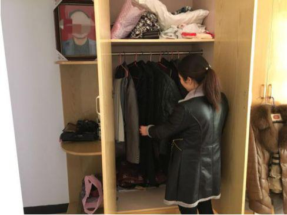
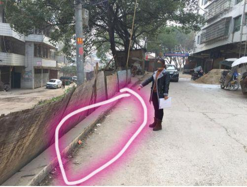
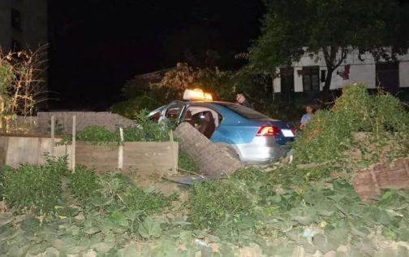
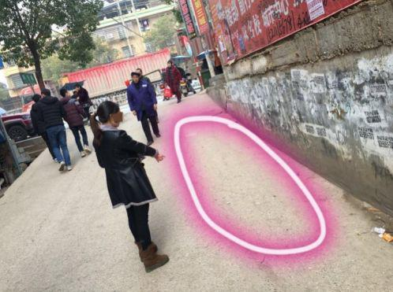

> 转：[保命还是送命?出租车司机两次“一键报警”后被害\_手机新浪网](https://news.sina.cn/2019-01-31/detail-ihqfskcp2104634.d.html)

---

## 保命还是送命?出租车司机两次“一键报警”后被害

原标题：[津云特稿]保命？送命？湖南祁东出租车司机两次“一键报警”后被害

来源：津云新闻

2018年7月15日，40岁的邹向科发了一条朋友圈：“我的寿命签：90岁”。未料想，这成为他所发的最后一条朋友圈。

2019年1月27日，湖南省衡阳市祁东县。邹向科的妻子唐美丽带津云新闻记者来到他们的家，家中摆放着邹向科的遗像。“事发虽然已近6个月，但是，我依然觉得老公走得很冤枉，这些天很多媒体都在关注我老公遇害的事。今年1月18日，我们家领了祁东津湘汽车经营服务有限公司劳动关系一案的22万元调解费，因为家里有三个小孩和两个老人，经济条件实在困难，但我从心里并不认可这种调解。我一直认为，如果我老公遇害前按下车内一键报警后，公司安全员没有回拨电话，没有激怒劫匪，我老公就不会遇害。”

唐美丽回忆，2018年8月1日凌晨2点14分，祁东的士司机邹向科，被17岁的持刀劫匪向某杀害。向某在向警方供述中表示：“当我知道那个司机触发他车子的报警后，我就一直在犹豫要不要杀了他。我的本意只是想抢钱……为了不让司机第一时间报警，不让别人知道是我做案，我就决心杀掉司机，用刀割了他颈部两刀。”

“我老公当时遇到抢劫后，两次按下车内一键报警，本意是想获得救援，未料想却在通话时被出租车公司安全员询问‘你在做什么事？为何要触发一键报警？’因而激怒了抢劫者，结果被杀。”唐美丽实在难以接受这样的结果。

### 凶手男扮女装

### 晚上十二点多上车

邹向科原本是家里的“顶梁柱”。

他和妻子唐美丽结婚十几年，攒钱买了祁东县一套115平米的小产权房。这套三室一厅的房子里，住着7口人，包括邹向科70岁的父亲和66岁的母亲，他的三个孩子（分别为15岁、11岁、5岁），以及邹向科和妻子唐美丽。

“家里经济压力大，因为祁东县出租车晚上收费比白天略高，所以我老公出车经常半夜两三点钟才回家。他开出租车两年了，之前偶尔会遇上打车不给钱的情况，但人没出过什么事儿，他开车身上只带些零钱，就是怕遇到抢劫的人。”唐美丽告诉津云新闻记者。

2018年8月1日凌晨0点43分，邹向科像往日一样，将车停在了祁东县主干道绿意阳光酒店门口，这里晚上比较热闹，周围有休闲会所，也时常有从酒店里出来的人坐车。

邹向科将出租车停在这里后，一位梳着长辫子的“女士”坐上了车，邹向科起初并没有意识到，这位“女士”是男扮女装，他就是最终杀害邹向科的向某。

0点50分，监控显示邹向科驾车路过了当地的春苗小学，然后向附近的田间小道行驶。凌晨1点04分，邹向科第一次按动出租车上的一键报警装置。

“按动一键报警装置后，车内摄像头开始抓拍车内情况，我后来从警方出具的资料看到，向某当时持尖刀架在我老公胸前。”唐美丽回忆，“然后，向某开始抢劫，我老公把身上仅有的几十元钱掏了出来，向某却没有下车，后来还逼迫我老公脱下身上的衣服，只剩一条内裤。”

此后的一段时间，邹向科仍在与向某周旋，期间曾开动车辆缓慢在附近行驶。凌晨1点46分，邹向科再次按动车内的一键报警装置。

“祁东津湘汽车经营服务有限公司安全员回拨电话给我老公，他一开始没敢接电话。后来向某意识到不对劲，逼我老公开着免提打回去。公司安全员就问我老公在哪里？为何要触发一键报警？我老公说他正在拉客，刚才是不小心碰到的。然后公司安全员提醒我老公小心一点，双方的通话就结束了。”

向某在向警方供述时称，“当我知道司机触发车子的报警后，就一直在犹豫要不要杀了他。我的本意只是抢钱……为了不让司机第一时间报警，不让别人知道是我做的案，我就下决心杀掉司机，用刀割了司机颈部两刀。”

### 死者妻子不解

### 一键报警是救人还是害人？

用刀割邹向科脖子，给邹向科致命伤害是在向某下车的时候。

在一路周旋后，邹向科在凌晨2点14分，将向某送到了当地成章学校，向某的亲戚就住在附近。向某在下车的一瞬间，用刀在邹向科脖子右侧划了很深的一刀，又在脖子左侧划了较浅的一刀，然后下车逃跑。

鲜血立即从邹向科脖子处涌出，他爬出车子后，用手摁着出血的脖子，一路走向祁东县的主干道求救。

凌晨2点17分，有人打电话报警。“是一对小情侣报的警，他们看到我老公用手摁着脖子，跌跌撞撞的走，一开始以为是个疯子。后来他们路过我老公的出租车，看到大量血迹，才知道发生了凶案，赶紧打电话报了警。”唐美丽回忆。

凌晨3点37分，唐美丽在睡梦中被电话叫醒，一开始只是被亲戚通知：“你老公出了点事儿，快来看下。”当时她还没意识到老公遇害。唐美丽赶到事发现场后，看到了倒在血泊中的邹向科。“他倒下的位置距离出租车约800米，这条小巷子晚上几乎没人。他想走到主干道被人发现，却在距主干道10米左右的地方倒下了。”唐美丽伤心地说。

“这半年来，婆婆整日以泪洗面，公公一只眼睛本来就不好，另一只眼也哭得看不清东西了……”唐美丽想不明白，“我老公按一键报警就是为了获救，但是他们公司直接给他回电话，还在通话中直接问出为何要触发一键报警，这是救人还是害人？”

### 出租车公司回应

### 回拨电话是工作流程

津云新闻记者在衡阳、祁东询问多位出租车司机，他们均表示一键报警后，公司安全员或者老板会回拨电话询问相关情况。“我开车一年多，半年前修车时误按了一键报警，公司老板就打电话问我是怎么回事儿。”衡阳出租车司机王峰（化名）告诉津云新闻记者。

“如果是正规有出租车从业相关证件的司机，公司会为司机买保险，司机一旦遇到危险和人身伤害，保险公司会进行相应赔付。”王峰说，“这也是对出租车司机的一种保障。”

“但是，祁东司机邹向科并没有出租车从业相关证件，他属于副班司机，是和主班司机签的合同。我们之前多次催邹向科去办理从业证，直到遇害他也没有办理，他也没有相应的保险。所以，我们只是本着人道主义精神，给了家属22万元。”祁东津湘汽车经营服务有限公司负责人熊先生告诉津云新闻记者，“另外，祁东这边的出租车司机按一键报警，按照程序我们都要打电话回去询问情况。这是一起刑事案件，承担责任的应该是凶手，邹向科遇害我们也很惋惜，但承担责任的不应该是我们。”

唐美丽对公司的这种说法并不认可：“如果不是公司直接回拨电话，并在通话中直接询问，或许我老公就不会遇害。另外，虽然我老公是副班司机，但也是他们公司的员工。两年前也向公司申报过出租车从业相关证件考试，但最终没有办下来。”

而邹向科的主班司机陈先生告诉津云新闻记者：“我和邹向科属于合作伙伴关系，车是同时出资买的，邹向科和我并非雇佣关系，他也属祁东津湘汽车经营服务有限公司的员工，主副班司机这种签法也是公司要求的。邹向科遇害后，公司给司机们开了多次安全会议，要大家加强安全意识。”

### 业内人士看法

### 多重措施保障司机安全

邹向科遇害的过程令人唏嘘，那么，出租车司机一键报警后，究竟应该如何处理，才能更好的保障司机安全？此前，据《每日人物》记者报道，多地出租车一键报警后安全员处理方式并不相同，“福建泉州司机车内一键报警后会收到回拨电话，苏州、济南不会直接回拨电话，而是通过车内监控设备先确定车内情况，有必要就直接拨打110报警。”

津云新闻记者咨询业内人士了解到，如今各地出租车的一键报警装置多是连接出租车公司和调度中心。为了保障司机安全，一键报警装置被触发后，安全员不直接回拨电话，而是通过监控先了解车内情况，再进行报警或有技巧的电话了解，更能保障司机安全，而且在技术上也完全能做到。同时，可以通过出租车内加装安全护栏，为司机购买相应保险等措施，多方面保障司机安全。

津云新闻记者 张赫洋 发自湖南祁东
