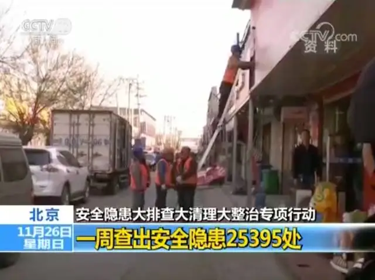
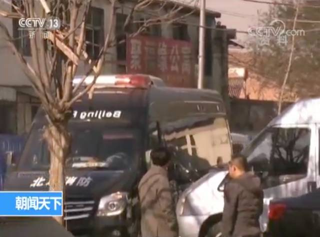

> 转：[北京安委会回应“驱逐低端人口”传言：从来没有“低端人口”一说](https://mp.weixin.qq.com/s?__biz=MTI0MDU3NDYwMQ==&mid=2656626191&idx=1&sn=bebf434625f9969f9fb756767e4e17e7)
> 转：[北京安委会回应“驱逐低端人口”传言：从来没有“低端人口”一说_新闻频道_中国青年网](https://news.youth.cn/sh/201711/t20171126_11065186.htm)
> 转：[两轮排查 隐患触目惊心-北京青年报](https://epaper.ynet.com/html/2017-11/26/content_270666.htm)
---

## 北京安委会回应“驱逐低端人口”传言：从来没有“低端人口”一说

<small>央视新闻 2017年11月26日 09:18 北京</small>

11月18日晚，北京大兴区西红门镇新建二村发生重大火灾事故，造成19人死亡，8人受伤。火灾发生后，北京市在全市范围内开展了为期40天的安全隐患大排查大清理大整治专项行动。目前，这次专项行动已进行将近一周，今天凌晨（26日），北京市就此次专项行动的最新成果进行了通报。

<video position= "absolute" width="100%" height="100%" controls="controls" src="/img/北京安委会回应“驱逐低端人口”传言：从来没有“低端人口”一说/weixinpub_bebf434625f9969f9fb756767e4e17e7_480P.mp4">
your browser does not support the video tag
</video>

### 专项整治一周 查出安全隐患25395处

北京市安全生产委员会相关负责人表示，此次专项行动主要是排查、清理、整治各项安全隐患，特别是火灾隐患，重点是“三合一”、“多合一”等重大消防隐患。这类建筑和工业大院把仓储、生产、人员居住等功能混为一体，人员密集，安全隐患突出，一旦发生火情极易导致重大人员伤亡。

专项行动展开一周，**北京全市仅消防系统就列出了9497件隐患场所清单，累计排查上账的安全隐患已多达25395处。**在查处的安全隐患中，包括：

有的企业用大量的易燃材料改建或扩建员工宿舍，薄薄的墙板一点就着，一旦有火星，都可能让整栋楼付之一炬；

有的工厂把厂房改成公寓出租，几百人住在一间狭小的厂房里，屋里屋外私拉的电线密得像蜘蛛网；

有些村民占着村里的疏散通道盖房群租，万一出事救火车、救护车都进不了村；

有些快递收发点里快递摞得两层楼高，屋里的插座一用就冒火星，不少快递员就住在里面，消防通道被密密麻麻的快递车完全堵死。

诸如此类的重大隐患，哪怕有一处发生火灾，都可能造成群死群伤，后果不堪设想。这些事实都说明，这次专项行动是非常及时的，非常必要的。

从目前的排查数据看，北京全市包括核心区、中心城区在内，各区都排查出了问题，最多的一个区摸排出近4000处隐患。

### 北京市安委会：不存在驱赶“低端人口”说法

另外，针对网上传闻的，此次专项行动是在驱赶“低端人口”的传言，北京市安全生产委员会相关负责人表示，**这是不负责任，也是毫无根据的，没有“低端人口”一说。**

这次专项行动的目的就是为了人民生命的安全。相关部门针对的，是存在安全隐患的违法建设和违法经营，针对的是一些经营者只顾私利无视安全法规、无视员工和租户安全的违法行为。需要说明的是，由于种种原因，一些外来人口选择了在这些场所工作和居住，但他们并不了解身处的危险。

为了他们的人身安全，为了不让悲剧重演，政府有责任采取必要的措施制止违法经营，消除严重安全隐患。政府的原则是生命至上，在这个问题上所有人都是平等的。**那些无视安全的非法经营，才是对生命的漠视。**

### 北京市安委会：拆除清理隐患前必须先发通告

针对有些地区的工作过于焦急，给搬迁群众的生活安置造成了暂时困难。北京市已下发通知，要求即时纠正此类问题，**在拆除清理隐患前必须先发通告，依法依规清理整治。**

### 北京市安委会：专项整治不是毕其功于一役

对于此次为期40天的大排查、大清理、大整治专项行动，是否要解决所有的安全隐患？相关负责人表示，这次专项行动是抢在火灾多发季节尽可能地消除最危险的安全隐患。对于北京这样的超大型城市，城市的安全治理是一项长期任务，不可能毕其功于一役。需要周密的工作计划，坚决、有序推进。最重要的，是要发动群众，唤起全社会的安全意识，精治、共治、法治，建立起长久的城市安全保障机制。

<small>监制/杨继红  主编/王兴栋</small>

<small>记者/王丰 张伟泽 编辑/王烁</small>

###### ©央视新闻
