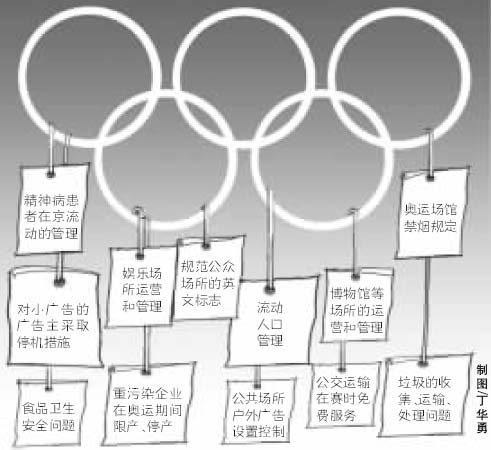

> 转：[奥运立法入实施阶段:奥运时进京人员或需县级证明 立法动态--中国人大新闻--人民网](http://npc.people.com.cn/GB/14957/53049/4819652.html)(原始链接)
> 转：[奥运立法入实施阶段:奥运时进京人员或需县级证明 立法动态--中国人大新闻--人民网](https://web.archive.org/web/20171209203852/http://npc.people.com.cn/GB/14957/53049/4819652.html)

---

### 奥运立法入实施阶段:奥运时进京人员或需县级证明

<small>31家单位接到首批65个奥运立法安排，包括机动车出行管理、节假日安排以及重污染企业停限产等</small>

<small>2006年09月15日08:18</small>

　　本报讯　奥运期间流动人口的管理问题、市区及奥运场馆周边车辆现行问题、奥运会期间放假问题将分别通过立法或者政府制定规范性文本的形式找到解决方案。昨日下午，北京市2008环境建设指挥部在北京会议中心向31个相关单位下发了第一批奥运立法的工作安排。

　　经过5个多月的研究确认，在第一批奥运立法需求中，确定65项需要研究解决的问题。昨天的奥运立法协调工作会标志着，第一批奥运立法项目已经进入了实质性的工作阶段。

　　这65个问题，有11个项目列入市政府立法工作计划。其中包括对残疾人特别是假肢人士的安检、外国人和团体在京的宗教活动以及重污染企业在奥运期间限产、停产等属于本市地方立法权限内等。

　　另有14个问题，需要北京和中央协调。其中包括设立外国代表团、奥林匹克贵宾进出境专用通道、外国人自驾车的证件换领和外国机动车管理、娱乐场所在奥运期间的运营和管理、奥运期间对进京人员的适当控制等。目前，市政府法制办和2008环境办正在进一步征求相关领域专家意见，之后起草形成统一报告，向国务院法制办统一报告请示。

　　还有7项问题不需要立法，但需要北京市政府或者主管部门制定规范性文件或者具体工作方案的事项。主要有奥运期间北京流动人口数量的管理以及外地机动车进京数量的控制等。工作小组建议，经请示国务院同意，可以发布通告，限制进京人员数量。如进京人员需要出具县级以上证明等，从根本上控制流动人口。“可劝返百万建筑民工”北京市奥运立法协调工作小组建议用4种方式控制流动人口数量

　　本报讯 在昨天下午的会上，关于2008北京奥运会期间的外来人口问题和在京的流动人口数量管理的问题，尤为吸引媒体关注。据了解，对流动人口的管理，协调小组建议拿出了4种方式来管理。

　　**建筑业农民工可劝返乡**

　　奥运立法协调工作小组认为，北京流动人口主要是从事城市基础建设项目施工的农民工，在奥运期间仅计算建筑业，北京预计有100万人。政府可要求建委协调施工单位建立企业整建制，对于这部分人劝返回乡。

　　对于流浪乞讨人员，政府将加强救助，特别是以《未成年人保护法》、《妇女儿童权益保护法》以及中央十九部委联合发文为依据，对未成年人实施强制性救助。根据记者的了解，北京市针对散发小广告群体中的未成年人，目前已经实施了强制救助。对于这部分未成年人，政府首先寻找其监护人，如果寻找无果，则由政府承担监护责任，进行强制性救助。

　　**加强行业规范限低端人口**

　　在会议材料里还介绍，今后将加强对流动人口出现问题较严重的低端行业的管理和规范。如废品收购、小美容美发等。在奥运期间，控制这一部分人口。材料显示，经请示国务院同意，可以发布通告，限制进京人员数量。如进京人员需要出具县级以上证明等，从根本上控制流动人口。

　　对于最后一部分，会上要求制定本市的规范性文件。

　　此外，奥运立法协调工作小组认为，奥运期间的进京人员大体分为两种情况：一为正常进京人员，如出差旅游、探亲访友；二为非正常进京人员，如流浪乞讨人员等。无论对哪部分人员进京实施控制，都需要其他省市支持配合。因此市奥运立法协调小组建议就此事请示国务院法制办。

　　■建言“提高建筑业门槛控制农民工”北京大学人口学教授陆杰华认为细化4项措施应人性化操作

　　对于上述控制流动人口的4项措施。北京大学人口学教授陆杰华表示可进一步细化，如提高建筑单位的资质要求。

　　陆杰华说，在行政手段上，可加强相关建设单位的资质要求和环境监测等监管力度，从而来促使一些建设停工等途径。市政府要按照北京市产业发展，来调整诸如废品收购，小美容美发等低端行业的发展，可以通过排查此类行业的相关证件，依法减少从业人员。同时利用行政手段加强各宾馆的管理。陆杰华认为，要做好由刚性政策转化人性政策实施的操作手段，转化合理的限制手法。他建议采取全民商讨，得出合理的可行性措施比较稳妥。也符合人文奥运和全民参与的奥运精神。

　　本版采写/本报记者 刘建宏 张伟峰 马力

　　**■环保问题**

　　●立法现状

　　**重大活动环保立法尚空缺**

　　《北京市实施大气污染防治法办法》只规定在空气严重污染的情况下可以对有关企业限产、停产，但没有规定在重大活动期间可以采取此类措施。因此，建议将修改《北京市实施大气污染防治法办法》列入2007年市政府立法工作计划，或者由市人大常委会授权政府在奥运期间可以采取严格的环保措施。

　　●回应

　　**重污染企业奥运时可能停限产**

　　北京市环保局科技和国际合作处处长李昕表示：“我们会想尽一切办法控制污染，比如研究是否按车辆排放状况在奥运期间限制行驶？污染严重是否需要关停、减产？长假制度是否可以有效降低污染排放等等”。

　　■出入境问题

　　●立法现状

　　**染艾人员入境法规不符奥运承诺**

　　奥运会期间对于传染病人员（包括艾滋病病毒携带者）检疫、导盲犬检疫以及外国特殊食品的检验，是否可以予特殊政策，特别是我国法律规定，包括HIVA阳性在内的四种疾病人员不得入境，与申办奥运时的承诺有矛盾。

　　●回应

　　**质检总局应有具体规定**

　　北京奥运立法协调工作小组建议：出入境检验检疫涉及对人、动物、食品、物品等几个方面的检验检疫，全国必须执行统一的标准，北京作为地方政府不应当制定特殊的政策。如奥林匹克大家庭成员可入境，其他的游客是否可以采取同样的标准对待。这些需要质检总局出台相关的规定。

　　首批65个奥运立法问题工作安排已向31个相关单位下发。

　　其中涉及了不少百姓关心的国计民生问题，现将部分立法问题列表如下。

<small>来源：《新京报》 （责任编辑：赵颖）<small>
