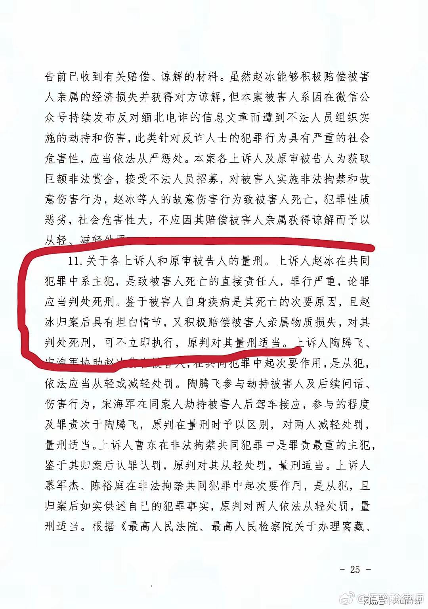
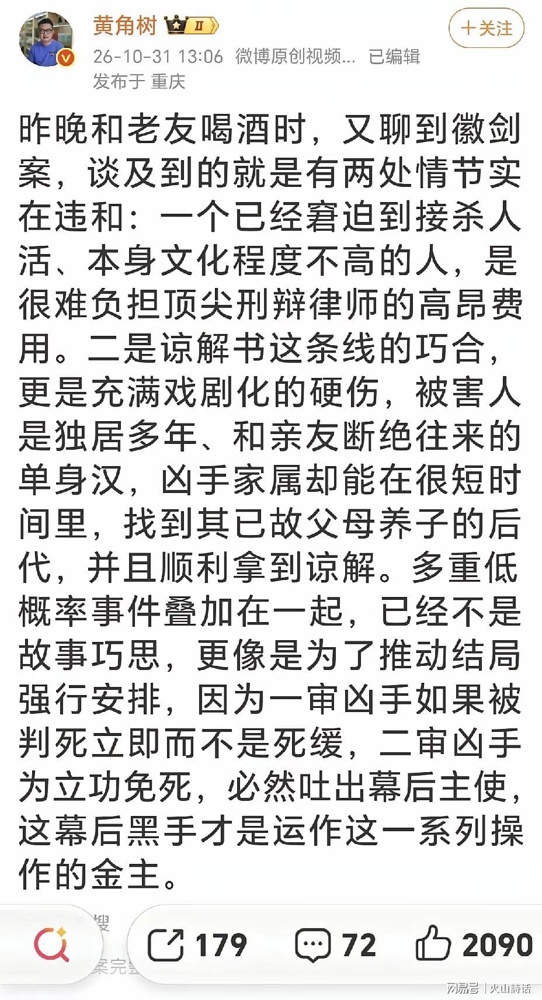
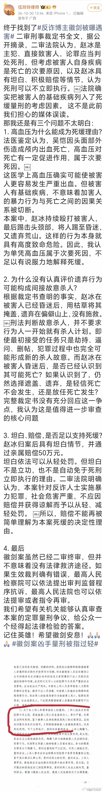
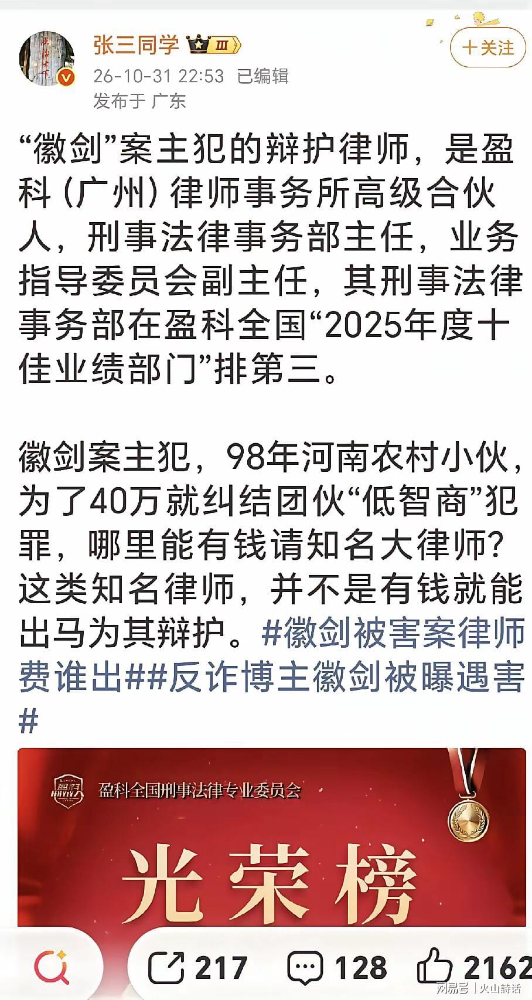
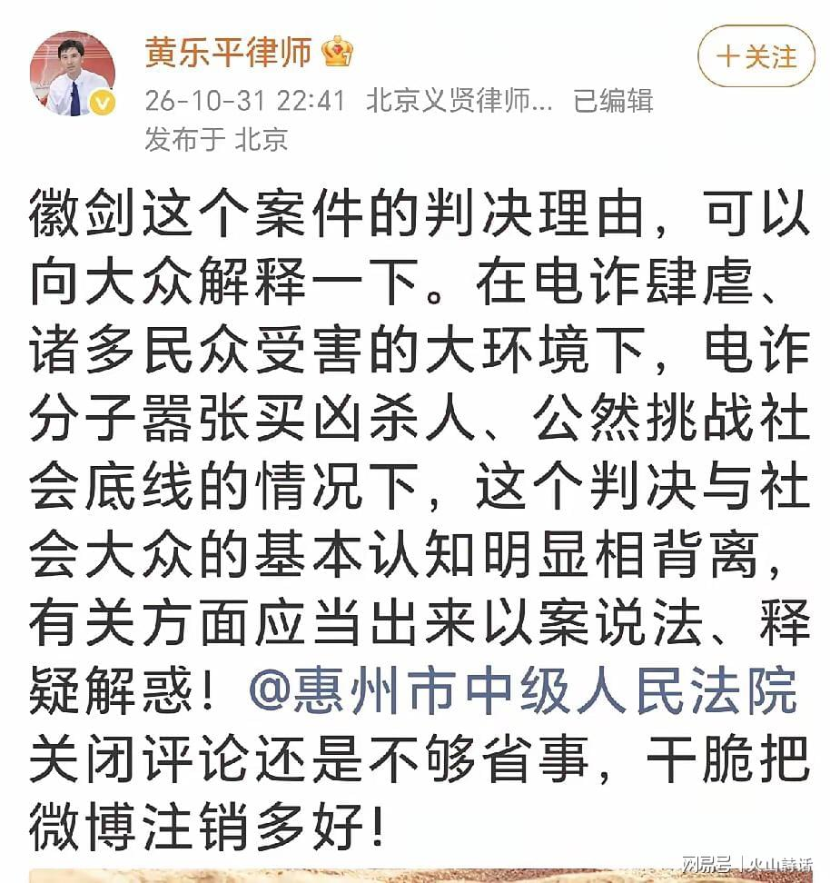
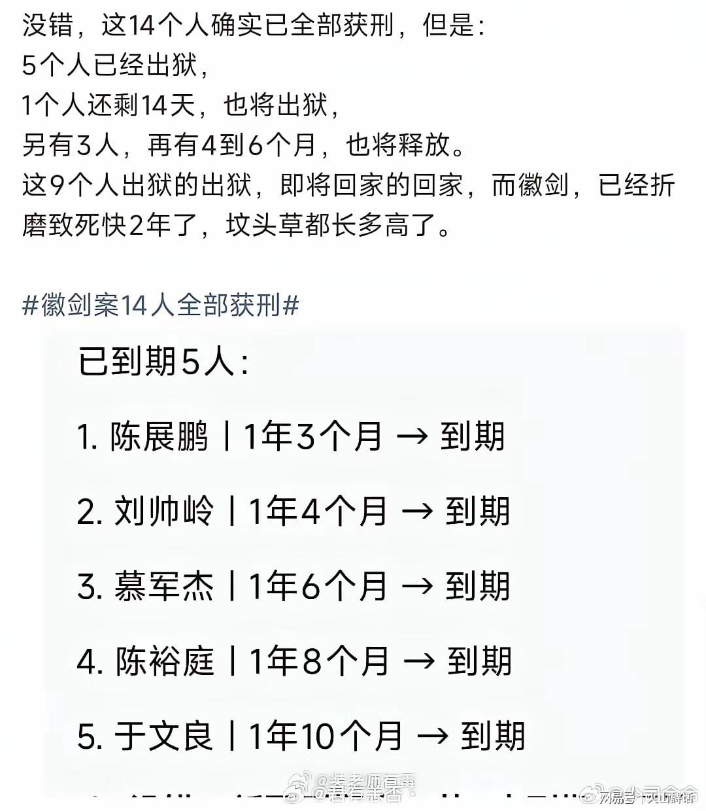
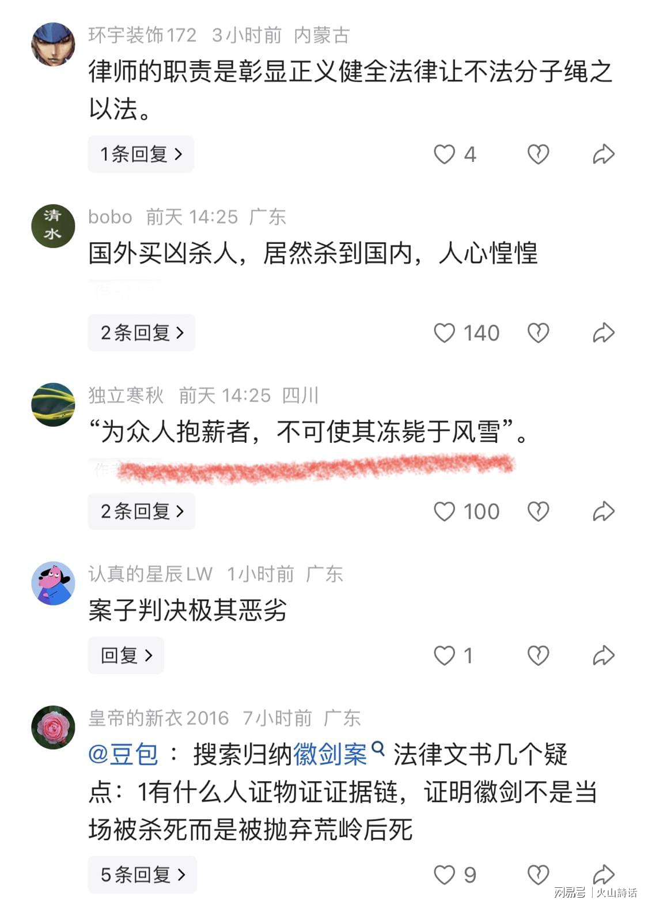
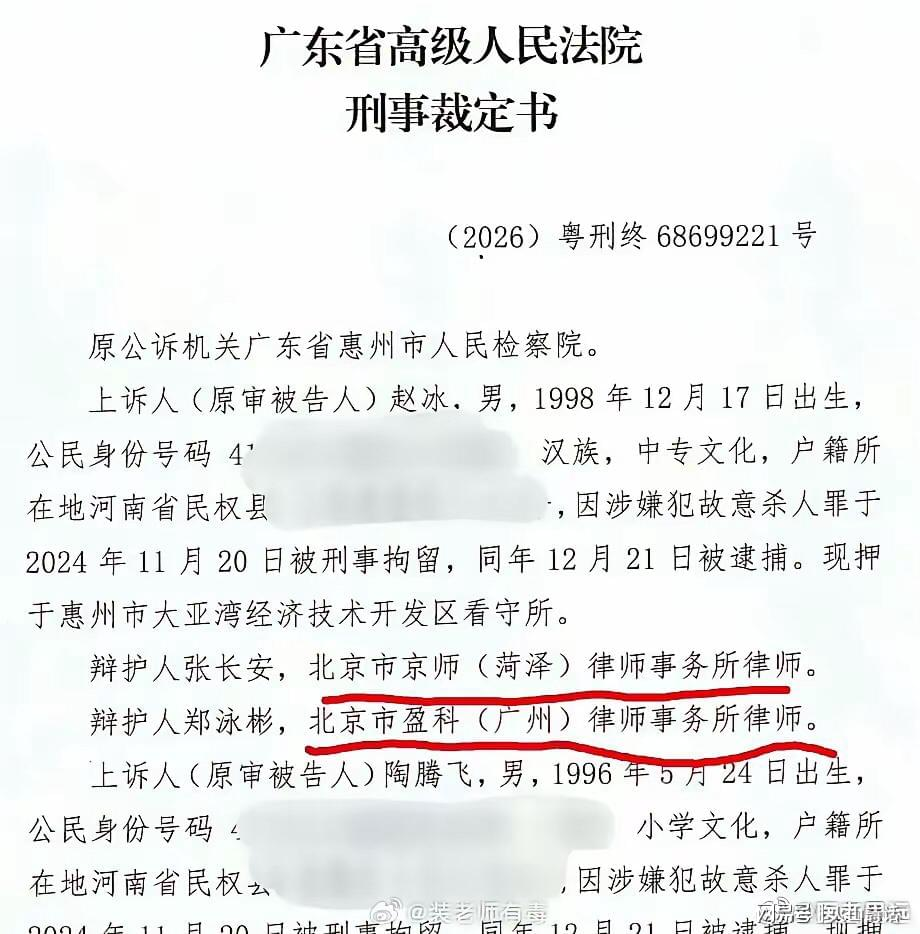
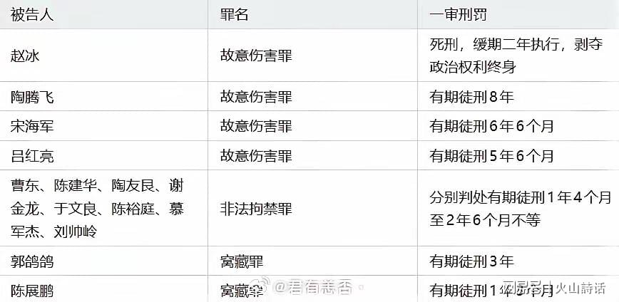
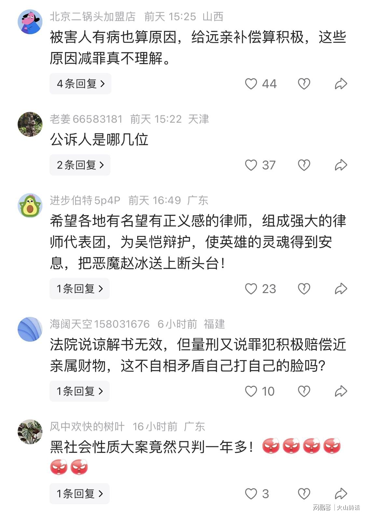

> 转：[徽剑案二审文书曝光！多名涉案人员刑期偏短已出狱，诸多知名律师站出来，提出更多观点和疑点|法院|主犯|同案|裁定书|刑事案件_网易订阅](https://www.163.com/dy/article/LAQJJ2H305564S43.html)

---

## 徽剑案二审文书曝光！多名涉案人员刑期偏短已出狱，诸多知名律师站出来，提出更多观点和疑点

###### 2026-11-03 13:54:11　来源: 火山詩话 湖南

近日徽剑案二审裁定曝光，反诈博主遇害一案舆论持续发酵。2024年，长期在网络上发布文章揭露缅北电诈黑幕的反诈博主徽剑（吴恺）遭遇劫持伤害，不幸身亡，该案自案发起就备受公众关注。

根据该案二审刑事裁定书，主犯赵冰被判处死刑，缓期二年执行，十四名涉案被告人均获相应刑罚，文书公开之后，迅速掀起一场围绕案件事实、量刑理由、程序细节的大范围讨论，不少法律从业者与普通网友纷纷发表各自看法。

梳理案件来龙去脉可知，被害人徽剑多年坚持曝光境外电信诈骗团伙的运作模式，他发布的多篇内容触动了电诈团伙的利益。境外人员开出悬赏酬金，招募人员对徽剑实施劫持、逼迫删帖，赵冰等人被四十万赏金吸引，接受任务，策划并实施了本次犯罪。

2024年11月，赵冰一伙找到徽剑，对其实施非法拘禁、殴打伤害，在徽剑昏迷之后，一行人将他遗弃在偏僻荒山，最终徽剑身亡。警方很快侦破案件，赵冰、陶腾飞、宋海军等一共十四名涉案人员先后落网。

一审阶段，法院经审理作出判决：主犯赵冰犯故意伤害罪，判处死刑，缓期二年执行，剥夺政治权利终身；陶腾飞、宋海军等其余被告人，分别依照故意伤害罪、非法拘禁罪、窝藏罪等罪名，判处一年三个月至八年不等的有期徒刑。宣判之后，赵冰提起上诉，广东省高级人民法院二审审理该案，最终裁定驳回上诉，维持原判，这份二审裁定书，也就是近期在网上曝光的文书。

裁定书里的量刑说理，是本次争议的核心。文书写明，赵冰是共同犯罪当中的主犯，是直接造成被害人死亡的责任人，论罪本应当判处死刑立即执行。但法院考量两项关键情节：一是被害人自身存在高血压基础疾病，该基础疾病是死亡的次要原因；二是赵冰归案之后能够坦白供述罪行，同时家属积极进行经济赔偿，取得被害方亲属的谅解。综合以上因素，法院决定对赵冰判处死刑，可不立即执行。

同时裁定书专门写明，本案是针对反诈人士实施的暴力犯罪，社会危害性极其严重，虽然赵冰取得谅解，但该谅解情节不予采信，不能以此从轻、减轻处罚。这段看似矛盾的表述，成为网友和法律人争论的焦点。

· 值得一提的是，不少专业律师在网络上提出自己的疑问。

有律师发文提出三点核心困惑：第一，法医鉴定认定死亡直接原因是头面部外伤引发颅内出血，高血压仅起到促进作用，属于次要死因，基础疾病是否足以成为留命死缓的支撑理由；第二，赵冰在被害人昏迷之后，用枯草掩盖被害人、遗弃荒山不予施救，该遗弃行为是否可以评价为间接故意杀人，裁定书没有专门回应这一争议点；第三，既然文书明确表明谅解不予采信，那么赔偿、坦白在量刑里的权重该如何界定。

同时还有观点指出，案件二审终审之后，依然存在审判监督的救济渠道，如果裁判确实存在错误，最高检可以提起抗诉，最高法也可以提审或者指令再审，期待案件能够得到更加充分的审查。

· 除了量刑本身，案件衍生出的其他疑问也在社交平台持续发酵。网友注意到，裁定书载明赵冰的两名辩护人分别为张长安、郑泳彬，其中郑泳彬是知名刑辩律师，这类高端刑事辩护收费高昂。

赵冰是1998年出生的农村青年，本身是为了四十万赏金铤而走险，不少网友提出疑问：他是否有能力承担高额律师费，辩护费用究竟由谁支付。与之相对，同案其余多数被告人，是由法律援助中心指派援助律师。同时，谅解书的获取过程也引来讨论：被害人徽剑常年独居，和原生亲友来往极少，凶手家属在短时间内找到其远亲并达成赔偿、拿到谅解，这一过程让很多网友觉得疑点重重。

另外，同案人员的刑期情况，也刺痛了很多网友。十四名被告人全部定罪判刑，但其中多人刑期较短，目前已经有五名被告人刑满释放，还有数名被告人将在数月之内陆续出狱。

一边是坚持反诈发声、付出生命代价的博主永远离开，另一边是多名参与作案人员短期内重获自由，强烈的对比，让不少公众在情感上难以接受。

大量网友留言引用“为众人抱薪者，不可使其冻毙于风雪”这句话，表达对反诈博主的惋惜，也希望针对电诈势力买凶害人这类恶性案件，量刑可以匹配公众对于打击黑恶电诈的期待。

从法律层面来讲，辩护权是我国刑事诉讼法赋予每一名被告人的法定权利，无论罪行轻重，嫌疑人、被告人都有权委托律师为自己辩护，这是法治的基本准则。即便是公众极度愤慨的恶性案件，也必须保障辩护制度正常运行，这一点是现代司法的共识。

同时，死缓本身是法定刑罚，法官需要综合全案证据、死因鉴定、认罪态度、赔偿情况等多重情节，在法律框架内裁量，法律评价和大众朴素的情感认知，本身就有可能存在距离。

但不可否认，本案的特殊性在于，这是一起境外电诈势力跨境悬赏、针对反诈发声者的报复伤害案件。电信诈骗已经让无数普通家庭蒙受巨额财产损失，而针对反诈博主的暴力报复，更是直接冲击社会安全感，挑战公共秩序底线，所以该案判决，天然承载着远超普通刑事案件的社会意义。

公众的质疑，本质上不只是针对一纸文书，更是希望司法裁判能够传递清晰信号：保护反诈从业者，严厉震慑境外电诈团伙的买凶报复行为。

网上的讨论，也给司法公开提出更高期待。面对汹涌的舆论和大量专业层面的疑问，很多法律界人士呼吁，办案机关可以适时以案释法，针对公众集中疑惑的死因认定、遗弃行为评价、量刑情节适用等问题，清晰释明裁判逻辑，消除误解，让判决不仅结果合法，说理也能够被社会理解。

徽剑案还在持续受到关注。反诈博主的牺牲令人痛心，而法治的意义，就是在惩治犯罪、尊重程序、兼顾法理与情理之间寻找平衡。舆论监督不是干预司法，公众的理性发问，也可以推动大家进一步理解刑事审判的规则边界。大家共同期待，这起案件的每一个细节都经得起法律检验，既守住程序正义，也告慰为反诈事业逝去的人，给所有持续和电诈斗争的人一份坚定的守护。

对此，你怎么看呢？

声明：取材网络，谨慎辨别

特别声明：以上内容(如有图片或视频亦包括在内)为自媒体平台“网易号”用户上传并发布，本平台仅提供信息存储服务。

Notice: The content above (including the pictures and videos if any) is uploaded and posted by a user of NetEase Hao, which is a social media platform and only provides information storage services.
