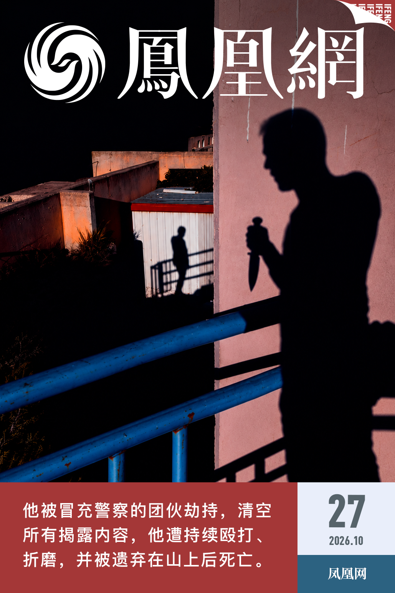
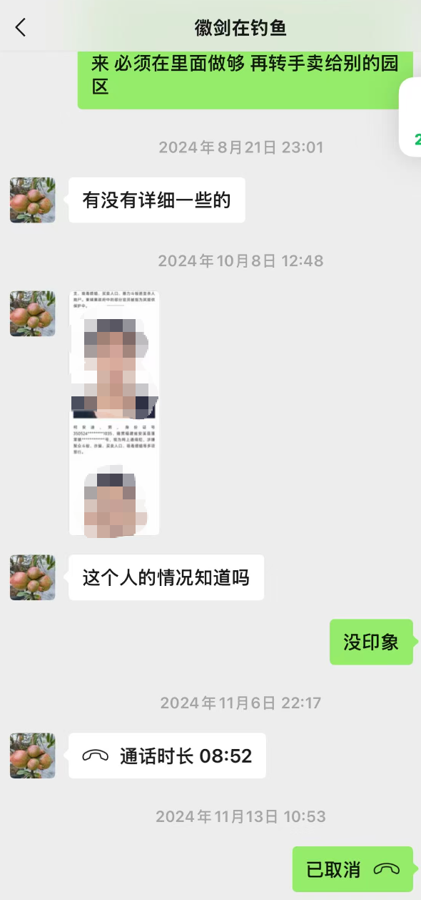
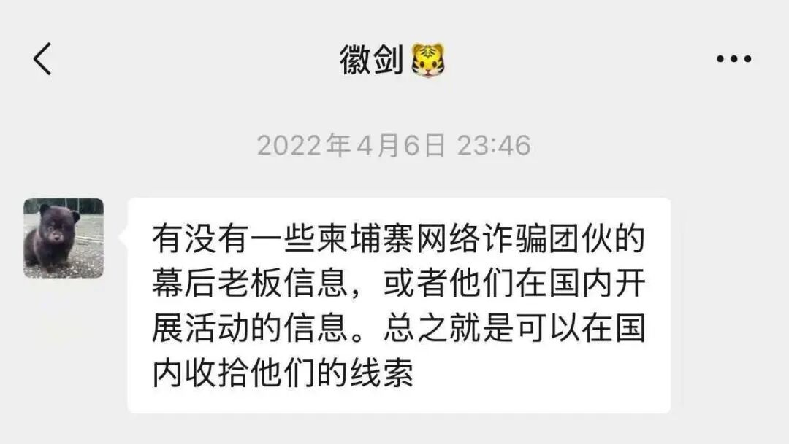
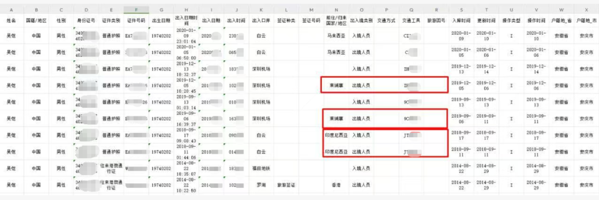
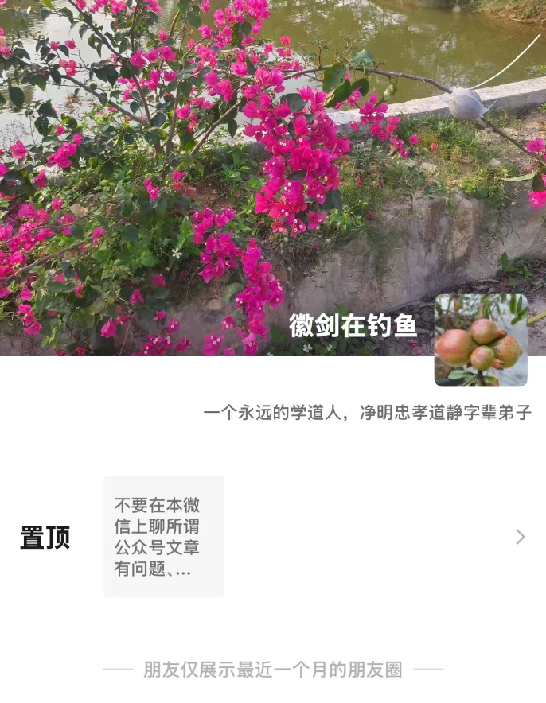

> 转：[广东省高院裁定：反诈博主“徽剑”吴恺被绑架致死，主犯赵冰获死刑_凤凰网](https://original.ifeng.com/c/8xZUmE8k5q0)

---

## 揭露电诈却遭绑架致死，友人还原“徽剑”遇害细节

###### 在人间 2026年10月27日 21:06:41 来自北京市

“竟然跟着网络一起，冤枉了他两年。”2026年10月26日下午，听说朋友吴恺早已遇害，张洋飞既震惊又愧疚。

吴恺早年是网络策划人、自媒体从业者，后来转型为持续曝光缅北、柬埔寨电诈内幕的反诈博主。在名为“徽剑”的抖音账号上，他在介绍一栏写道，“根据大家的要求，开始发布东南亚相关视频”。

三位与他有过接触的朋友告诉凤凰网，他生前曾参与帮助卷入电诈的中国人脱离困境。

据界面新闻报道，2024年8月起，他公开揭露东南亚诈骗产业链，曝光柬埔寨安徽商会原会长刘忍涉嫌赌场暴力放贷、殴打致死装修老板、收取商铺保护费、运营电诈园区、武装化跨国犯罪。**同年11月10日，他被一个冒充警察的团伙劫持、拘禁，清空公众号所有揭露内容，他遭持续殴打、折磨，并被遗弃在山上后死亡。**

直到今天，广东省高级人民法院（2026）粤刑终68699221号刑事裁定书被媒体公开，朋友们才知道吴恺被非法拘禁、被暴力手段伤害致死的全过程，不是网络传言中的“因敲诈勒索他人而入狱”。而他曾揭露的刘忍也以电诈集团骨干的身份于2026年6月被押解回国。

在反诈自媒体圈子里，一直存在收钱删帖的传闻，有人担心，被曝光者会以付钱删帖等方式设局，再以敲诈勒索为由举报。过去张洋飞还以为吴恺就是落入了这样的圈套，认为“（入狱的）徽剑应该快出来了吧”。

吴恺被劫持前四天，2024年11月6日晚上10点，张洋飞与他通过一次8分钟语音电话，但具体聊了什么，他如今已记不清。他们平时谈的，多是涉诈线索、救援，以及反诈领域的一些乱象。

这次通话七天后，2024年11月13日，张洋飞在Telegram聊天群组里看到了“徽剑因敲诈勒索被抓”的消息，他立刻拨打吴恺的电话，已无人接听，“可能真的出事了”。吴恺没有妻儿，父母已经过世，也没有其他亲近的人可以打听更多消息。

也是在这一天，江西赣州定南县龙塘镇，有村民在公路旁的山上发现了吴恺的遗体。而张洋飞正打开吴恺公众号“徽剑”，发现几乎所有内容都被清空，还以为那是做实吴恺“敲诈勒索”的后续清理措施，“他真的坐牢了”。一起做反诈自媒体的圈内人，拿此事彼此提醒：即便出于情面删帖，也不能收钱，不能给人留下把柄。

据广东省高级人民法院刑事裁定书，绑架吴恺、清空公众号“徽剑”，是一个以“赵冰”为首的团伙做的。赵冰2024年10月在Telegram群里接受网名为“少校”的人发布的有偿劫持他人任务，11月10日，三名同伙冒充警察，趁吴恺停车取物时将他架上车带走，随后逼问其公众号幕后“主使”，删除文章。第二天，吴恺被带至江西赣州定南县一处山上。赵冰用脚踢其头部致其昏迷，拍照发给“少校”，天黑后用枯草将他盖住，遗弃在山上。

值得注意的是，赵冰将吴恺的手机交给“少校”安排的名为“谢义辉”的人，裁判文书中显示其为“在逃”。凤凰网拨打吴恺手机号，已显示为空号。

两年后，2026年10月26日，界面记者循着裁判文书追查、核实身份，朋友们才知道吴恺的真实死因。

张洋飞这时才回忆起，吴恺遇害前一个多月，刘忍的手下曾找到他一位身在柬埔寨的朋友，试图打听吴恺在国内的住址等信息，但遭到拒绝。

张洋飞与吴恺相识于疫情。在公众号介绍页面里，吴恺自称“半个厨子，钓鱼运动选手、高尔夫捡球高手”，形容自己的性格是“5成严谨、3成霸道、2成逗比、1成奇葩”；在现实中，张洋飞回忆，吴恺戴着眼镜，个头不高，“和蔼、正派，说话做事有理有据，不满口跑火车”。平时两人会交流与东南亚电诈有关的话题，也曾一起帮助被骗去园区的电诈受害者脱困。

2024年下半年，两人曾在深圳见面。当时，一名女大学生被骗至越南，遭到绑架。女孩的父母带着绑匪发来的视频等材料求助，吴恺研究视频的可信程度，和几位朋友凑在一起商量如何联系园区里的人，从中周旋，寻找解救女孩的机会。据张洋飞回忆，这位女孩后来顺利获救。

参与解救电诈受困者的人，需要在受困者和园区人员之间周旋，圈子里，大家默契地不细问彼此的真实身份，“因为对他们也是一个保护”，张洋飞说，他在圈里认识五六年的朋友，也从来不会问对方真实名字。张洋飞知道“徽剑”本名叫吴恺，是源于一次有关网络争论的闲聊。

据他回忆，吴恺曾因批评缅甸果敢同盟军，受到一些支持者的攻击而卷入网络骂战。有攻击者在他的真名里加了一个字表示讽刺。吴恺与张洋飞聊天时说：“我明明叫吴恺……”张洋飞记住了这个名字。

张洋飞记得，有两个缅甸的网红，网上一边倒说两人是给缅北电诈公司拉人头的，吴恺会通过自己认识的渠道查找信息，澄清两人的身份，提醒网友不要人云亦云；当网络上笼统讨论某个国家有多危险时，他也会找来数据，试图把讨论拉回具体事实依据上。

另一位朋友冯跃风认为，吴恺是关注东南亚电诈问题的自媒体创作者中“最敢的人”，“别人不敢指名道姓曝光的东西，到他那儿，他是真的敢”。

他和吴恺相识于一个柬埔寨中国人互助微信群。群里有被骗去柬埔寨做电诈的获救人员、遇难者家属，也有在柬埔寨当地经营酒店、餐厅的商人，以及愿意帮忙的普通人。遇到生病需要捐款、客死异乡但家属无力承担火化费用之类的困难，大家就在群里凑钱。

2021年前后，吴恺经朋友介绍加入了该群。冯跃风记得，一名在柬埔寨做生意的山东籍男子遇害后，因家庭困难，在群里发起过捐款，吴恺捐过200元。

此后，冯跃风时常和吴恺打电话、通视频，却始终没有在线下见过面。他们交流的内容大多与东南亚电诈有关。有时，吴恺会向他了解一些涉诈人员的情况，交换过线索。

据他回忆，吴恺曾持续点名曝光一些中国在柬埔寨当地的商会负责人，其中就包括柬埔寨安徽商会会长刘忍。据公开报道，刘忍于2026年6月被从柬埔寨押解回国，他是陈志犯罪集团的骨干成员，参与创立的金贝集团在柬埔寨运营网络赌博平台、经营电诈园区，刘忍本人涉嫌非法拘禁、故意伤害等严重暴力犯罪。

“2024年，他（指刘忍）可是如日中天的”，冯跃风说，面对一些有财力、有社会关系的曝光对象，他们发布内容时往往会隐去商会名称和个人姓名，改用代称。一方面担心文章被投诉、下架，另一方面也是保护自己，避免卷入诉讼或遭到报复。

而吴恺的做法更直接。“他真的是一直盯着曝……你曝得太直白了，万一人家动用关系收拾你，告你个侵权诽谤什么的就进去了……我们当时还没想到，（居然）人会雇凶害他。”冯跃风说。

冯跃风还曾在境外网络上看到吴恺被公开个人信息，包括出入境、酒店住宿，以及户籍等记录。他没有逐一核实这些材料的来源和真实性，但私人信息被集中公开，在境外网络上是普遍现象。

在他的印象里，吴恺听不进朋友的劝告，“他挺认自己的一个理”，“是个理想化的人，认定一件事，就很难改变”。

冯跃风与吴恺最后一次联系，是在他出事前三天。那次，他们聊起了短剧，冯跃风当时提议，一起整理电诈被骗的真实案例，把接触到的故事拍出来，或许能提醒更多人警惕境外高薪招聘和偷渡陷阱。吴恺答应了，还邀请他到广东惠州见面详谈。可是，“没等去，他就失联了”。

冯跃风曾发消息问：“你出事了咋的？”但没有收到回复。后来看见网上说吴恺因敲诈勒索被抓，他也相信了这种说法。

得知吴恺遇害，也让同样游走在园区和家属之间做反诈的冯跃风重新审视自己面临的风险。“我现在陌生人都不见了。”他说，担心有人以见面等方式设局接近自己。

得知吴恺死讯的当天，两位朋友也看到了案件的判决结果：主犯赵冰，在非法拘禁过程中使用暴力手段伤害被害人身体，致被害人死亡，依照刑法第二百三十八条第二款的规定，其行为构成故意伤害罪，对其判处死刑，可不立即执行。其余13名涉案人员被判处一年至八年有期徒刑。

刑事裁定书中明确写道：“本案被害人系因在微信公众号持续发布反对缅北电诈的信息文章而遭到不法人员组织实施的劫持和伤害，此类针对反诈人士的犯罪行为具有严重的社会危害性，应当依法从严惩处。”

冯跃风认为该案涉及境外雇凶、境内绑架致死，影响恶劣，希望境外指使者能够继续被追查、追责。

裁定书中还提到，主犯赵冰通过其母亲向被害人“徽剑”家属赔偿50万元，受委托人吴正结于2025年12月出具刑事谅解书，对涉案14人表示谅解。

吴正结10月27日向新京报表示，确有此事，此前有两名身材魁梧的男子到家中寻找其父亲（即“徽剑”父母养子），吴正结报警后得知对方系凶手家属一方。吴正结还表示，为避免再生事端，最终签署了谅解书。

张洋飞为这个生前遭到伤害、死后又背负误解的朋友而不平。他希望人们记住吴恺，也记住“徽剑”公众号主页上的那句话“位卑未敢忘忧国”，记住他是一个“戴着眼镜，外表普通，一个有正义感的‘油腻’中年人”。

应对方要求，文中张洋飞、冯跃风为化名

作者 广坤 ｜ 编辑 燕青

排版 魏蔚

[责任编辑：李冠宏 PX246]

(本文章版权归凤凰网所有，未经授权，不得转载)
