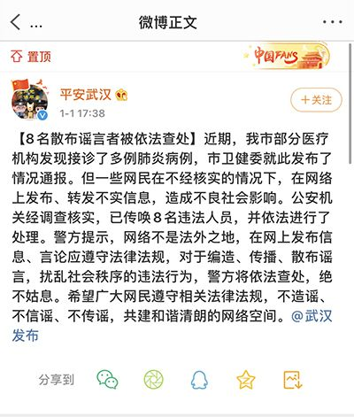

> 转：[武汉8名散布肺炎疫情谣言者被查处--领导留言板--人民网](http://leaders.people.com.cn/n1/2020/0102/c58278-31531814.html)

---

## 武汉8名散布肺炎疫情谣言者被查处

2020年01月02日08:39 | 来源：[人民网-湖北频道](http://hb.people.com.cn/n2/2020/0101/c192237-33681157.html)

<small>原标题：武汉8名散布肺炎疫情谣言者被查处</small>

1日下午，武汉市公安局官方微博发布消息称，关于武汉市肺炎疫情的情况，8名散布谣言者，已被依法查处。

近日，武汉部分医疗机构发现接诊了多例肺炎病例，武汉市卫健委就此发布了情况通报。但一些网民在不经核实的情况下，在网络上发布、转发不实信息，造成不良社会影响。公安机关经调查核实，已传唤8名违法人员，并依法进行了处理。

警方提示，网络不是法外之地，在网上发布信息、言论应遵守法律法规，对于编造、传播、散布谣言，扰乱社会秩序的违法行为，警方将依法查处，绝不姑息。希望广大网民遵守相关法律法规，不造谣、不信谣、不传谣，共建和谐清朗的网络空间。（肖璐欣）

**相关阅读：**

[网传武汉出现不明原因肺炎 国家卫健委专家组已赴武汉调查](http://hb.people.com.cn/n2/2019/1231/c192237-33678978.html)

[武汉市卫健委通报肺炎疫情 所有病例均已隔离治疗](http://hb.people.com.cn/n2/2019/1231/c194063-33679188.html)

[武汉不明原因肺炎不能断定是SARS，7例病情危重](http://hb.people.com.cn/n2/2019/1231/c192237-33679037.html)

[武汉华南海鲜市场休市整治 开市时间另行通知](http://hb.people.com.cn/n2/2020/0101/c192237-33680870.html)

[武汉8名散布肺炎疫情谣言者被查处](http://hb.people.com.cn/n2/2020/0101/c192237-33681157.html)

(责编：于新怡、唐嘉艺)
