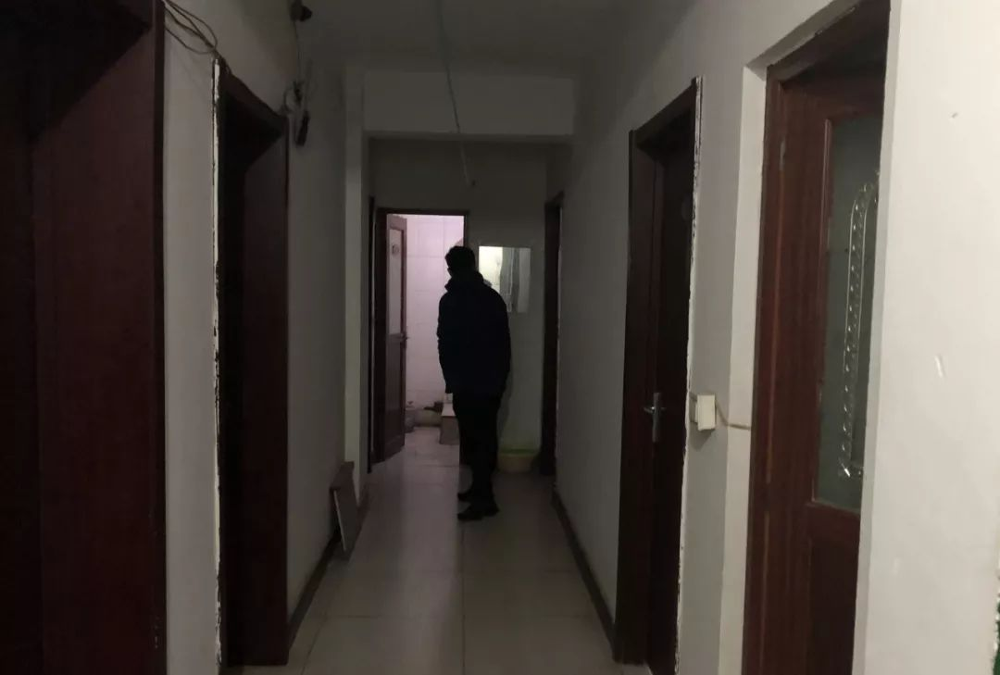
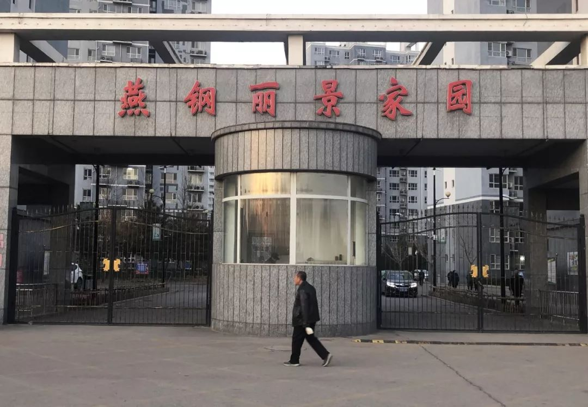
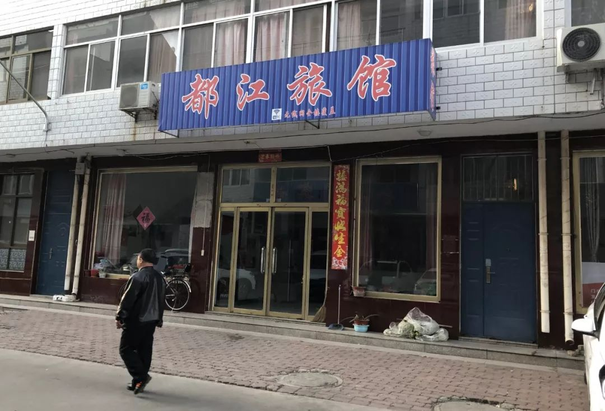
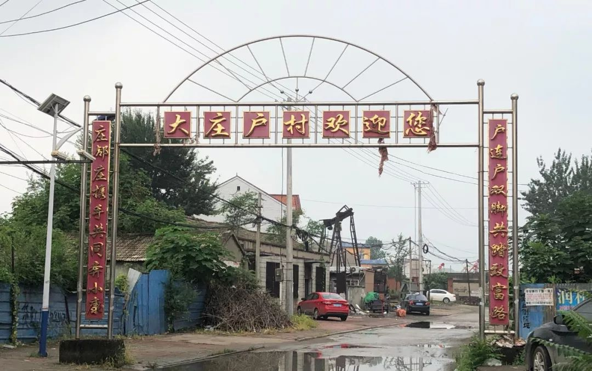
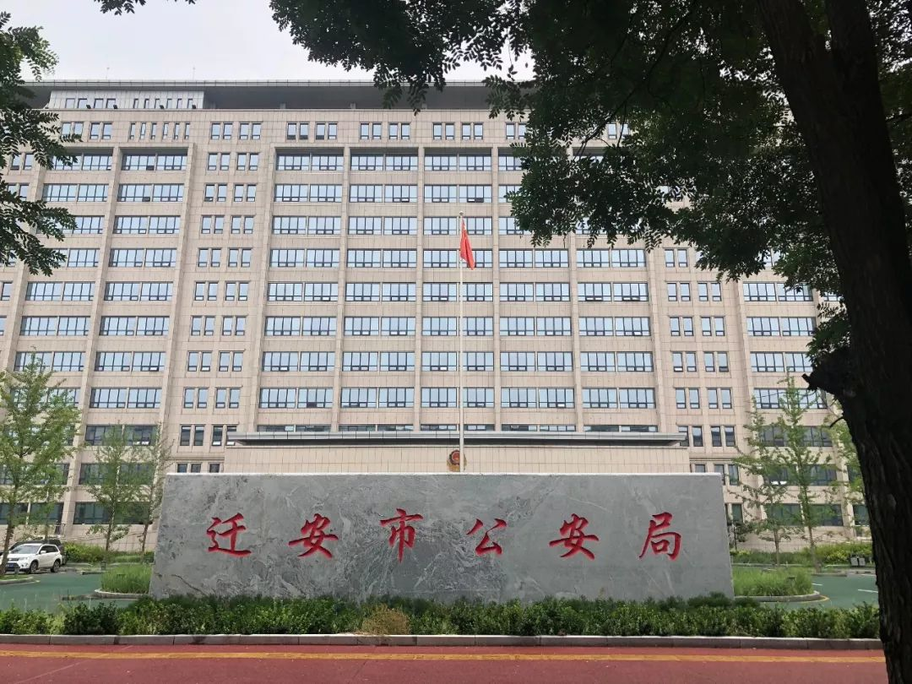

> 转：[河北迁安未成年少女性侵案：多名女孩被输送给当地人大代表、富商_凤凰网](https://ishare.ifeng.com/c/s/7sGpErmzkv2)

---

## 河北迁安未成年少女性侵案：多名女孩被输送给当地人大代表、富商

##### 新京报

###### 2019/12/09 20:05

**有知情人向新京报记者透露，康永、王双的落网仅揭开了迁安性侵案的冰山一角，该案疑有数十名涉案人，其中包括公职人员、富商、人大代表等。**

**团伙成员王家壮曾在这里涉嫌强奸了一名未成年少女。新京报记者 王翀鹏程 摄**

2018年3月，河北省迁安市公安局抓获了一个长期“碰瓷”的恶势力犯罪团伙。该团伙以故意撞车剐蹭来敲诈勒索钱财。

但在审讯过程中，迁安民警发现了更严重的罪行——该团伙成员主动供述，曾强奸、轮奸了数名未成年少女，并强迫她们卖淫赚钱。

就在这个涉及十二人的恶势力团伙陆续落网之际，**迁安市公安局党委副书记康永却坐不住了，他给负责查办团伙案件的民警和负责人塞钱，希望他们不再继续侦查。**

这一举动为他招来了法网。2018年7月，康永因行贿被唐山市监委留置调查，随后主动交代，自己也牵涉其中，性侵未成年女孩。

公安在之后的侦查中发现，**牵涉其中的人还有迁安市人大代表王双。**

有知情人向新京报记者透露，康永、王双的落网仅揭开了迁安性侵案的冰山一角，该案疑有数十名涉案人，其中包括公职人员、富商、人大代表等。

2019年8月5日，康永一案被唐山法院终审判决，法院审理查明，**被告人康永在2017年暑假至2018年初期间，曾与六名不满十四周岁的幼女，八次发生性关系。康永犯强奸罪、受贿罪、行贿罪，合并执行有期徒刑16年6个月。**

**公安局副局长落网**

今年54岁的康永，案发前曾任迁安市公安局党委副书记。与其熟识的一家旅店老板描述，他个头很高、方脸、眼睛不大，白头发不少，一副严肃的面孔。45岁起便担任迁安市公安局党委副书记、副局长，分管全市治安等工作。

马丽是康永向警方回忆起接触到的第一个女孩。康永记得，两人第一次见面是2017年暑假。当时，马丽穿了件很时髦的衣服，衬托出匀称的体型，没有化妆。中间人带她来见康永，康永还问了她的年龄。

当年，马丽只有13岁。

康永的一审判决书显示，马丽回忆，2017年10月，康永化名“真诚”，通过QQ联系马丽，希望她帮忙找点“丫头”，马丽介绍了第二个女孩——13岁的付曼。

一个周日的下午，付曼上完补习班，马丽带她去了和康永约定的地点——迁安市燕钢丽景花园内的一间单元房。

后来，付曼向办案民警回忆，当时自己并不情愿，康永脱衣服的时候她反抗了，但又怕马丽打她，因此顺从了。

判决书中称，每次发生关系之后，康永会给女孩1000元至3000元不等的嫖资。除了马丽，经常和康永联系的中间人还有另外两个。每隔一段时间，就有人给他介绍女孩。长则一两个月，短则十几天。

康永落网后，一个曾为他介绍女孩的中间人向警方回忆，康永还提出想找处女，愿意开价上万。

**警方调查发现，与康永发生关系的女孩大多是职业高中的学生或刚毕业的无业人员。**

每次见到女孩，康永只询问她们的年龄和所在年级，并不多谈它事。他谎称是中医院的大夫，女孩们没人知道他的真实身份和姓名，都叫他“医生”。

**康永曾在这里涉嫌强奸了两名未成年少女。新京报记者 王翀鹏程 摄**

判决书中显示，康永自述，从2017年暑假到2018年初，半年之内，康永先后与六名不满十四周岁的幼女，八次发生性关系。最后一次是在2018年初，康永记得问了女孩年纪，女孩说她16岁了，而实际上她只有13岁。

后来，康永两次在自书中写道：“说实话，到现在我也不知道，她们当中谁是不满十四周岁的。”

面对警方，女孩们也承认谎报年纪。她们曾对办案民警称，中间人让她们自称年满14岁，有时候还要求她们化妆，打扮得很成熟。

2017年冬天，马丽给康永介绍了12岁的刘红。刘红个子很高，但身体还没发育完全。为了掩盖真实年龄，马丽事先教刘红化了妆，“因为化上妆显得年龄大。”

**“碰瓷”团伙牵出大案**

归案后，康永交代，他是从2016年开始参加卖淫嫖娼活动的，他和女孩们的秘密交易维持了近两年。直到一恶势力团伙落网。

2018年初，一恶势力团伙因故意剐蹭酒驾人员车辆，试图敲诈25000元，和受害人闹到了迁安市公安局交通警察大队。办案民警经过调查发现，他们是一个长期“碰瓷”的团伙，将他们列入调查范围。

警方传唤了团伙成员宁大龙。11月26日，宁大龙的父亲告诉新京报记者，民警说是涉及“车”的事情，让宁大龙去趟局里配合调查。传唤当天，宁大龙就回家了。但一个月后，他再次因为车子的事被传唤。这次，他不仅交代了开车碰瓷，还向办案民警揭发了另外两名团伙成员——王泽众和王家壮。

接受迁安警方审讯时，宁大龙称，王泽众和王家壮曾多次强奸、轮流强奸未成年女孩，还介绍、强迫她们卖淫赚钱，他也曾参与其中。2018年3月23日，宁大龙被迁安市公安局以强奸罪刑事拘留，当时他还不满18岁。

几天之后，王泽众和王家壮被警方控制。警方侦查发现，他们是涉恶团伙的主要成员。

就在这个恶势力团伙纷纷落网之际，康永坐不住了，开始向同一公安局内的三名同事行贿，包括迁安市公安局党委委员、刑警大队教导员、刑警大队副中队长。归案后，他交代，行贿是为了隐藏自己的犯罪行为，包庇了这个犯罪团伙，阻止警方查案。

在警方审讯中，该团伙嫌犯供述，**曾对多名女孩采用殴打恐吓并实施强奸、轮奸，之后，通过中介将受害女孩输送给官员、人大代表、富商嫖娼。**

三人向迁安警方交代的第一起强奸案，案发2017年10月份，受害者是15岁的女孩杨丽丽。每次，王家壮都用暴力手段威胁她。据此团伙的判决书显示，他们用同样的手段，殴打、语言威胁并强奸过多名女孩。

**团伙成员王家壮曾在都江宾馆涉嫌强奸了一名未成年少女。新京报记者 王翀鹏程 摄**

涉案团伙的判决书中称，2018年1月1日至春节前后，一个半月内，李萍萍三次遭到王家壮、王泽众、宁大龙三人的强奸。李萍萍稍有不听话，就遭到几个人的殴打和语言威胁，被打几次后，李萍萍就不敢反抗了。

王家壮等三人向警方交代，他们还利用同样的手段，三次强奸或轮流强奸过一个15岁的女孩。之后，逼迫该女孩介绍新的女孩。

**被强迫的未成年少女**

王泽众和王家壮都是迁安镇沙河子村人，年龄相差12岁。他们都是早早辍学，外出打工，平时很少回家。

村里人对他们的了解并不多，只知道今年33岁的王泽众离婚再娶，和前妻育有一个儿子，平时跟随爷爷奶奶生活。对于王家壮，他们了解得更少，只能说清他父亲去世前爱喝酒，脑子有些“魔怔”。

宁大龙的父亲告诉新京报记者，宁大龙是家里最小的孩子，14岁辍学后一直跟着父母做生意。“如果我知道他一直和小帅（王泽众）来往，一定把他的腿打断。”

女孩们除了供王泽众三人奸淫，还被用来抵债或挣钱。2018年2月中旬，王家壮为了还清欠王泽众的钱款，曾将一个未满18岁的女孩介绍给王泽众卖淫抵债。

他们强迫女孩外出卖淫。曾被他们奸淫的女孩杨丽丽、李萍萍、王媛媛等人，后来成了他们赚钱的工具。**如果女孩不愿意，王家壮等人就会以到女孩家里闹事、拍摄裸照、不雅视频、殴打等方式要挟。**

王泽众、王家壮等人将女孩的信息发布到网上招嫖。归案后，他们向警方供述，嫖资都被他们三人挥霍了。

后来，李萍萍成了团伙成员胁迫女孩卖淫的“帮手”。团伙为胁迫女孩王媛媛去卖淫挣钱，王泽众让李萍萍在她面前讲述自己被殴打的经历，王媛媛听完，吓得不敢反抗，之后被带到迁安市丽都景苑小区一套日租房内，向一个40岁左右的男子卖淫，获取了1000元嫖资。

2018年12月25日，河北迁安法院对王泽众、王家壮等人强奸、敲诈勒索一案进行开庭审理。经审理查明，王家壮、王泽众和宁大龙强奸妇女，强迫未成年人卖淫，从中非法获利1万余元。

据团伙成员交代，杨丽丽被他们强迫卖淫。两个月内，她接了六个客人，其中包括迁安市公安局党委副书记康永，以及迁安市人大代表、大庄户村村主任王双。但在康永的供述中，并未提及杨丽丽。

**涉案人王双此前是迁安市人大代表、大庄户村村支书。新京报记者 王翀鹏程 摄**

2018年7月26日，王双的哥哥告诉新京报记者：“7月6日那天晚上，当时王双正在家里休息，几个便衣警察敲开家门将其带走，之后，家人从警察那里得知，王双因嫖娼被抓。9日，警方报请迁安市人大委员会许可，王双被刑拘。”

11月27日，大庄户村委会委员王军介绍，王双早已被法院判决，至于判了多长的刑期并不知情。

据知情人透露，目前暴露出的只是整起案件的冰山一角。除了康永和王双，还有多名公职人员涉案。去年，迁安当地曾有传闻称，数十名当地的公职人员及富商被警方调查，部分涉案人员因为没有证据坐实，并未受到处罚。但截至发稿，记者暂未核实到该说法。

**性侵案之后**

2018年7月，康永被唐山市监委留置。之后，监委将案件移送唐山市检察院，检察院指派古冶区检察院管辖并批准逮捕康永。

《中华人民共和国刑法》第二百三十六条规定，奸淫不满十四周岁的幼女，以强奸论，从重处罚。这意味着，不管采用什么手段、幼女是否同意，只要与不满14周岁幼女发生了性关系，就属于奸淫幼女的行为，并构成强奸罪。

**涉案前，康永是迁安市公安局的党委副书记。 新京报记者 王翀鹏程 摄**

2019年8月5日，唐山中级人民法院终审判决，康永犯强奸罪，判处有期徒刑15年；受贿罪、行贿罪判处有期徒刑4年6个月，合并执行16年6个月。康永在受贿、行贿案中退缴的181万元予以上缴国库，并处罚金40万元。

常给康永介绍女孩的其中一个中间人，2018年7月2日被迁安市公安机关传唤。经讯问，她陈述了其被他人多次介绍卖淫、并多次介绍他人卖淫的犯罪事实。但因她不满十六周岁，警方未对她进行立案侦查和采取强制措施。

2019年1月30日，恶势力团伙案被迁安市法院一审宣判，两名主犯王家壮、王泽众数罪并罚，获刑十九年，宁大龙获刑十七年。其余十名被告也分别获刑，王双的案子也进入司法程序。

2018年8月23日，唐山市政府网发布“迁安市教育局暑期整治校园及周边治安环境”消息。该消息称，8月6日，市教育局与政法委联合召开校长座谈会，分别阐述了本单位校园周边存在的问题，并提出了建议和意见。并对校园及周边存在的安全隐患进行了分析归纳，增强了校园周边治理工作的针对性和实效性。

该消息还称，8月13日开始，公安、市场监管、城管、住建等11个部门50余名工作人员，分4个检查组联合执法检查。通过对学校周边公寓进行摸排检查，要求将公寓名称、举办者姓名、联系方式、具体位置等两百多家公寓上报政法委和公安局治安大队。

12月9日，新京报记者联系迁安市教育局的工作人员，试图了解案发后教育系统对此事的后续处理结果。办公室主任白主任称：“我不清楚，不负责这个，应该咨询安全法制卫生科。”随后，教育局安全法制卫生科科长表示，不了解情况。截至发稿时，教育局局长刘东友电话未接、短信未回复。
